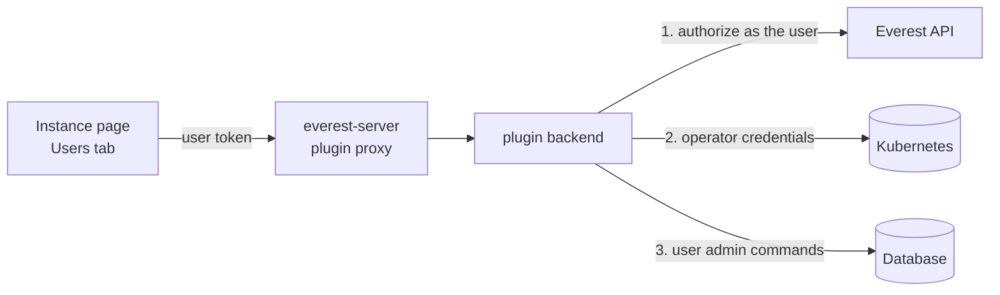

# plugin-user-management

OpenEverest plugin for managing database users and their roles, right on the
instance page, so teams stop sharing the admin account and don't need a
database shell to onboard an application.

It adds a **Users** tab that lists the instance's users and lets you create
users, change their roles, reset their passwords and delete them. Generated
passwords are shown once, with an in-cluster connection string, and are not
stored anywhere.

Supported providers:

| Provider | Engine |
|---|---|
| `percona-server-mongodb` | Percona Server for MongoDB (replica sets and sharded clusters) |

## How it works



1. Every request is authorized by calling the Everest API **with the caller's
   token** (see [Permissions](#permissions)).
2. The backend picks the **engine** for the instance's provider, which reads
   how to reach the database and the operator's user-administration
   credentials from Kubernetes.
3. The engine runs the database's own user commands (for MongoDB `usersInfo`,
   `createUser`, `updateUser`, `dropUser`).

Users live in the database only; the plugin keeps no state and doesn't touch
the Instance or the operator's resources.

### Permissions

| Action | Requires (Everest RBAC) |
|---|---|
| See the Users tab | `use` on the plugin (`plugins`, `<cluster>/plugin-user-management`) |
| List users | `read` on the instance |
| Create, change roles, reset password, delete | `read-connection` on the instance |

Changing users takes `read-connection` because whoever can read the instance's
admin credentials can already manage its users with them; the plugin doesn't
introduce a new permission.

Two more rules keep the plugin from becoming a privilege escalation path:

- **Only a curated set of roles can be granted.** Roles that reach user or
  cluster administration of the whole instance (MongoDB `root`,
  `userAdminAnyDatabase`, `clusterAdmin`, `backup`/`restore`, ...) are not
  offered, and database-scoped roles can't target the `admin`, `config` or
  `local` databases.
- **Only users holding grantable roles can be changed.** The operator's system
  users and any user with roles outside the curated set are shown read-only,
  so editing a user can never strip or hand out privileges the plugin
  doesn't manage.

### Engines

An engine implements one provider ([backend/internal/engine/engine.go](backend/internal/engine/engine.go)):

```go
type Engine interface {
    Roles() []Role // the roles the plugin can grant
    ListUsers(ctx, target) ([]User, error)
    CreateUser(ctx, target, NewUser) (Credentials, error)
    UpdateRoles(ctx, target, id, []RoleGrant) error
    ResetPassword(ctx, target, id, password) (Credentials, error)
    DeleteUser(ctx, target, id) error
}
```

Engines are keyed by provider name (Instance `spec.providerRef.name`) in
[backend/main.go](backend/main.go). The HTTP API, authorization, password
generation and the UI are engine-agnostic: the UI renders the roles the engine
returns, as database-scoped (granted on a database the user picks) or
cluster-scoped. Adding a provider means adding an engine, its RBAC rules in the
chart, and the provider to the tab's `providers` (in
[src/main.tsx](src/main.tsx) and the chart values).

#### MongoDB

- Reads the `PerconaServerMongoDB` named after the instance for its host and
  TLS mode, and connects as the operator's user administrator
  (`MONGODB_USER_ADMIN_*` in the users Secret it references). With
  `tls.mode: requireTLS` it trusts the CA from the cluster's TLS Secret.
- Creates users in the `admin` database (the usual `authSource`).
- Grantable roles: `read`, `readWrite`, `dbAdmin`, `userAdmin`, `dbOwner` on a
  database; `readAnyDatabase`, `readWriteAnyDatabase`, `dbAdminAnyDatabase`,
  `clusterMonitor` on all databases.
- Users named in the operator's users Secret are system users.

## Requirements

- OpenEverest with plugin support (`plugins.extensions.openeverest.io` CRD).
- An instance of a supported provider. The backend connects to the database
  from the plugin's namespace, so NetworkPolicies must allow that traffic.

## Installation

```bash
helm install plugin-user-management charts/plugin-user-management \
  --namespace everest-system
```

| Value | Default | Description |
|---|---|---|
| `plugin.extensionPoints[0].providers` | `[percona-server-mongodb]` | Providers that get the Users tab |
| `everestAPIURL` | discovered | Everest API the backend authorizes against |

The chart's ClusterRole lets the backend `get` Secrets and
`perconaservermongodbs` in every namespace (database namespaces are created
dynamically). It is used only after the Everest API has authorized the caller
for the instance.

## API

Served under `/v1/clusters/{cluster}/plugins/plugin-user-management` by
everest-server. Every endpoint takes `?namespace=&instance=`.

| Endpoint | Body | Returns |
|---|---|---|
| `GET /api/users` | | `{users, roles, canManage}` |
| `POST /api/users` | `{username, password?, roles}` | `201` credentials `{username, password, uri}` |
| `PUT /api/users/{id}/roles` | `{roles}` | `204`; the roles replace the user's roles |
| `POST /api/users/{id}/password` | `{password?}` | credentials |
| `DELETE /api/users/{id}` | | `204` |

`roles` are `[{role, database?}]`; `database` is only set for
database-scoped roles. An empty `password` is generated (24 letters and
digits). User IDs are opaque (MongoDB: `<authDatabase>.<username>`).

## Development

```bash
npm install
make test             # backend + frontend tests
make build-frontend   # dist/main.js
make docker-build IMG=<registry>/plugin-user-management:dev
```

### Testing on a cluster

With OpenEverest and a supported provider installed on the cluster of your
current kubeconfig context:

```bash
make dev-registry     # throwaway in-cluster registry (dev/registry.yaml)
make dev-deploy       # build, push to it and helm upgrade --install the plugin
kubectl create namespace um-test && kubectl apply -f dev/demo-instance.yaml
```

`make dev-deploy` needs Docker and installs
[crane](https://github.com/google/go-containerregistry) if it's missing. The
dev registry has no auth or TLS; don't use it outside test clusters.

The frontend is an ES module loaded by the Everest UI and shares the host's
React (see [vite.config.ts](vite.config.ts)). The backend embeds it and serves
it at `/main.js`.

### Releasing

Push a `vX.Y.Z` (or `vX.Y.Z-<suffix>`) tag. The release workflow builds the
bundle and a multi-arch image, pushes the image and the Helm chart to GHCR
(`oci://ghcr.io/openeverest/charts/plugin-user-management`) and creates a
GitHub release with notes.

## Roadmap

- Engines for PostgreSQL (`provider-percona-postgresql`) and MySQL
  (`percona-xtradb-cluster`).
- Custom roles: list and grant roles defined in the database, and manage them.
- Optionally keep credentials in a Kubernetes Secret per user, for apps that
  mount them.
- Configurable role catalog per installation.
