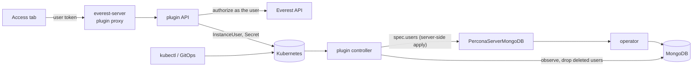

# plugin-user-management

OpenEverest plugin for managing database users and their roles, so teams stop
sharing the admin account and don't need a database shell to onboard an
application. For models served through the Envoy AI Gateway, the same users
are API keys: one per application, team or person, instead of one shared key
per model.

Users are declared as Kubernetes resources, `InstanceUser`, and reconciled
into the instance's database. Create them from the **Access** tab on the
instance page or with `kubectl`/GitOps; either way the plugin keeps the
database in sync, stores generated credentials in a Secret applications can
mount, and drops the user when the resource is deleted. On PostgreSQL, the
databases of an instance and their owners are declared the same way, as
`InstanceDatabase`s, from the same tab or with `kubectl`/GitOps.

Supported providers:

| Provider | Engine |
|---|---|
| `percona-server-mongodb` | Percona Server for MongoDB, through the operator's `spec.users` |
| `provider-cloudnative-pg` | CloudNativePG 1.30+, through the operator's `DatabaseRole` resource |
| `provider-percona-postgresql` | Percona Operator for PostgreSQL, through SQL as the operator's `postgres` superuser |
| `provider-kserve` | API keys for models on the Envoy AI Gateway, through the provider's key Secrets |

## InstanceUser

```yaml
apiVersion: plugin-user-management.plugins.openeverest.io/v1alpha1
kind: InstanceUser
metadata:
  name: orders-service
  namespace: team-a          # the instance's namespace
spec:
  instanceRef:
    name: orders-db          # immutable
  username: orders_svc       # immutable
  roles:
    - role: readWrite
      database: orders
    - role: clusterMonitor   # cluster-scoped roles take no database
  # passwordSecretRef:       # optional: bring your own password
  #   name: orders-svc-password
  #   key: password
status:
  phase: Ready               # Pending | Ready | Failed | Deleting
  credentialsSecret: orders-service-credentials
  conditions: [{type: Ready, status: "True"}]
```

- Without `passwordSecretRef` the plugin generates a password into
  `<name>-credentials` with keys `username`, `password` and `uri` (an
  in-cluster connection string). The Secret is owned by the InstanceUser.
  Editing its `password` rotates the password in the database.
- `Ready` means the user exists in the database with exactly the declared
  roles. Role changes go back to `Pending` until the database matches.
  PostgreSQL users may have no roles, such as the owner of an
  `InstanceDatabase`; other engines require one. On PostgreSQL, `read` and
  `readWrite` are granted on one InstanceDatabase (see
  [Per-database roles](#per-database-roles)).
- Deleting an InstanceUser drops the user from the database (finalizer
  `plugin-user-management.plugins.openeverest.io/drop-user`). InstanceUsers
  are owned by their Instance, so deleting the instance deletes them.

See [examples/instanceuser.yaml](examples/instanceuser.yaml) (MongoDB),
[examples/instanceuser-postgresql.yaml](examples/instanceuser-postgresql.yaml)
(CloudNativePG),
[examples/instanceuser-percona-postgresql.yaml](examples/instanceuser-percona-postgresql.yaml)
(Percona PostgreSQL) and
[examples/instanceuser-kserve.yaml](examples/instanceuser-kserve.yaml)
(an API key for a model).

## InstanceDatabase

Supported for `provider-cloudnative-pg` and `provider-percona-postgresql`.
Manage them from the **Databases** section of the instance's **Access** tab,
next to **Users**. It lists the managed databases with their owner, who can
connect and status, next to the instance's other databases. There you create
a database for an owner (a user of the instance; it needs no roles), change
its owner or who can connect, and delete it, keeping its data or, after
typing its name, dropping it. In the **Users** section, `read` and
`readWrite` are granted on one of these databases, picked from a list.

```yaml
apiVersion: plugin-user-management.plugins.openeverest.io/v1alpha1
kind: InstanceDatabase
metadata:
  name: orders
  namespace: team-a          # the instance's namespace
spec:
  instanceRef:
    name: orders-db          # immutable
  name: orders               # immutable; [a-z_][a-z0-9_]*, at most 63
  owner:
    instanceUserRef:
      name: orders-owner     # an InstanceUser of the same instance
  deletionPolicy: Retain     # Retain (default) | Delete
  connect: Public            # Public (default) | Granted
status:
  phase: Ready               # Pending | Ready | Failed | Deleting
  owner: orders_owner
  available: true            # applied at least once
  conditions: [{type: Ready, status: "True"}]
```

- The database is created once the instance is ready and the owner's
  InstanceUser has been created in it (it may still be `Pending`, e.g.
  waiting for a role on this very database); until then it's `Pending` with
  the reason. `status.available` is set once the database and its roles
  have been applied, and stays set.
  `Ready` means the database exists with that owner. Changing the owner
  changes the owner of the database, not of the objects in it.
- **No takeover**: a database that exists before the plugin claims its name
  fails, as do PostgreSQL's own databases and those the provider or operator
  creates. One InstanceDatabase per database name and instance; the oldest
  wins.
- Deleting an InstanceDatabase (finalizer
  `plugin-user-management.plugins.openeverest.io/release-database`) with
  `Retain` stops managing the database and keeps it, so pruning it from Git
  never loses data; with `Delete` it drops the database. If PostgreSQL
  refuses, e.g. while sessions are using the database, the InstanceDatabase
  stays `Deleting` with the reason (see the engines for how sessions are
  handled). InstanceDatabases are owned by their Instance.
- The owner's InstanceUser can't be deleted while it owns a database:
  PostgreSQL refuses to drop the role and the InstanceUser stays `Deleting`
  with the reason until the database is dropped or given another owner.
- Users get access to one database with the `read` and `readWrite` roles on
  it (see [Per-database roles](#per-database-roles)).
- `connect` tells who can connect to the database. With `Public`,
  PostgreSQL's default, every user can, but without a role on it they can't
  read or change its tables. With `Granted` (`REVOKE CONNECT ... FROM
  PUBLIC`) only its owner, the users granted `read` or `readWrite` on it and
  superusers can, besides the operator's roles that connect to every
  database, which keep `CONNECT` when they exist: PgBouncer's auth user
  (`_crunchypgbouncer` on Percona, `cnpg_pooler_pgbouncer` on
  CloudNativePG), CloudNativePG's metrics exporter and the monitoring users.
  Users with a predefined role such as `pg_read_all_data` can't connect to a
  `Granted` database without a role on it. Switching back to `Public` grants
  `CONNECT` to `PUBLIC` again.

### Per-database roles

```yaml
kind: InstanceUser
spec:
  instanceRef: {name: orders-db}
  username: orders_app
  roles:
    - role: readWrite        # or read
      database: orders       # an InstanceDatabase of the same instance
```

- `read` reads the database's tables, views and sequences; `readWrite` also
  inserts, updates and deletes rows and uses sequences. Neither can create,
  alter or drop objects: that's the owner's.
- They cover the objects that exist and those the **owner creates later**
  (default privileges), in every schema the owner creates. Migrations should
  run as the owner, or `SET ROLE` to it; objects created by other users aren't
  covered.
- Each InstanceDatabase gets two group roles, `oe_<database>_read` and
  `oe_<database>_readwrite` (hashed when longer than 63 characters), holding
  those privileges; granting a role makes the user a member, so revoking it
  takes effect right away. They're listed as system users, and usernames
  can't start with `oe_`.
- A user granted a role on a database whose InstanceDatabase hasn't been
  applied yet (`status.available`) is declared with its other roles and
  stays `Pending` until it has. Once available, the roles stay granted even
  while the InstanceDatabase is briefly `Pending`, e.g. during an owner
  change. Deleting the InstanceDatabase revokes them; dropping the database
  drops its group roles.

See [examples/instancedatabase.yaml](examples/instancedatabase.yaml).

## How it works



The backend is one binary with two parts:

- **API** for the UI: authorizes every request against the Everest API with
  the caller's token (see [Permissions](#permissions)), then creates, patches
  or deletes InstanceUsers and their Secrets. It lists users by merging the
  InstanceUsers with the users that exist in the database.
- **Controller** (controller-runtime, leader-elected) reconciling
  InstanceUsers per instance. It hands them to the instance's **engine**,
  which declares them in the database operator's own API, observes the
  database to report status, and drops users that are deleted.

The plugin ships its own CRD and controller rather than relying on the host:
it's the standard Kubernetes extension model and lets the controller watch
what it depends on (the operator's resources, Secrets).

### MongoDB engine

- Declares the users in the `PerconaServerMongoDB` (named after the
  Instance) `spec.users`, with server-side apply under the field manager
  `plugin-user-management`. The provider applies the rest of that resource
  under its own field manager and never sets `spec.users`, so they don't
  conflict. The operator creates the users in the `admin` database, keeps
  their roles in sync and applies password changes from the Secret.
- The operator doesn't remove users that leave `spec.users`, so the
  controller drops deleted users itself, as the operator's user
  administrator (`MONGODB_USER_ADMIN_*` in the users Secret).
- Reads users with `usersInfo` to report status. With `tls.mode: requireTLS`
  it trusts the CA from the cluster's TLS Secret.
- Grantable roles: `read`, `readWrite`, `dbAdmin`, `userAdmin`, `dbOwner` on a
  database; `readAnyDatabase`, `readWriteAnyDatabase`, `dbAdminAnyDatabase`,
  `clusterMonitor` on all databases.

### CloudNativePG engine

- Declares each user as a CloudNativePG `DatabaseRole` named
  `<instance>-<username>-<hash>`, owned by the `Cluster` (named after the
  Instance) and labeled with the instance. The role can log in, is a member of
  the granted roles (`inRoles`) and takes its password from the user's
  Secret. The operator creates the role, grants and revokes memberships and
  applies password changes.
- The plugin labels password Secrets `cnpg.io/reload: "true"` so password
  changes apply right away. CloudNativePG reads the `password` key and checks
  that the Secret's `username` key matches the user: generated Secrets have
  both; a `passwordSecretRef` must use the `password` key and also hold
  `username`.
- `DatabaseRole`s use the `retain` reclaim policy, so deleting one by hand
  keeps the role. To drop a user the controller switches its `DatabaseRole`
  to `delete` and deletes it. The InstanceUser stays `Deleting` until the
  operator has dropped the role; if the role still owns objects, PostgreSQL
  refuses and the operator's error is shown until they're reassigned or
  dropped.
- Reads roles and memberships from `pg_roles` over TLS, verified against the
  cluster's CA, as the application owner (`<cluster>-app`), or the superuser
  when that's the only Secret. When a declared user isn't applied, the
  `DatabaseRole`'s error is reported in the InstanceUser's status.
- `postgres`, `streaming_replica`, `cnpg_*`, the application owner and roles
  in the Cluster's `spec.managed.roles` are listed as system users. Roles
  declared by other `DatabaseRole`s are listed too, even before they exist, so
  the plugin never declares the same role.
- Grantable roles are `read` and `readWrite` on one InstanceDatabase, and
  PostgreSQL's predefined roles, which apply to all databases:
  `pg_read_all_data`, `pg_write_all_data` and `pg_monitor`. Usernames are at
  most 63 characters and can't be `postgres`, `streaming_replica` or start
  with `pg_`, `cnpg_` or `oe_`.
- An InstanceDatabase's group roles are `DatabaseRole`s like users', without
  login. CloudNativePG declares memberships but not object privileges, so the
  plugin grants the group roles theirs itself, connected to the database **as
  its owner** with the owner's password: no superuser access is needed. It
  grants on the objects the owner owns that lack a privilege, and sets the
  owner's default privileges.
- The connection string points at the read-write service and the
  application database, with `sslmode=require`.
- The operator applies a `DatabaseRole` when it or its Secret changes; it
  doesn't revert changes made to the role in SQL. Such drift shows up as
  `Pending` until the user's roles or password change again.
- Each InstanceDatabase is a CloudNativePG `Database` named
  `<instance>-<database>-<hash>`, owned by the `Cluster`, labeled with the
  instance, with the `retain` reclaim policy. Releasing it deletes the
  `Database`; dropping it switches the policy to `delete` first, and the
  operator runs `DROP DATABASE`, which waits for every session on the
  database to close. CloudNativePG's error for a `Database` is
  shown on the InstanceDatabase.
- The application database (`spec.bootstrap.initdb.database`) and databases
  that other `Database` resources declare, such as the provider's own for
  extensions, are reserved.

### Percona PostgreSQL engine

The operator's `spec.users` can't grant role memberships (it applies
`options` with `ALTER ROLE`), only takes passwords from Secrets it writes
itself, and never drops users. So the plugin manages users in SQL and leaves
`spec.users` to the provider:

- Connects to the primary (`<cluster>-primary`) as the operator's `postgres`
  superuser (`<cluster>-pguser-postgres`, which the provider always declares),
  over TLS verified against the CA in `<cluster>-cluster-cert` (or
  `spec.secrets.customTLSSecret`).
- Each user is a login role with no other attributes (`NOSUPERUSER`,
  `NOCREATEDB`, `NOCREATEROLE`, `NOREPLICATION`, `NOBYPASSRLS`), a member of
  exactly the granted roles, and commented `Managed by OpenEverest`. Every
  reconcile restores the attributes, grants missing memberships and revokes
  others, so changes made in SQL are reverted.
- Passwords are read from the user's Secret, under any key, and sent as
  SCRAM-SHA-256 verifiers, never in plain text. A role's password is only
  changed when its stored verifier doesn't match the Secret.
- The plugin only ever alters or drops roles carrying its comment, whatever
  the InstanceUser says. Deleting a user runs `DROP ROLE`; if the role still
  owns objects or holds privileges, PostgreSQL refuses and its error is shown
  while the InstanceUser stays `Deleting`, until they're reassigned or dropped.
- `postgres`, `monitor`, `ccp_monitoring`, `everest-monitor`, `_crunchy*` and
  the users in the `PerconaPGCluster`'s `spec.users` are listed as system users,
  even before they exist, and can't be declared: the operator would take them
  over.
- Grantable roles are the same as for CloudNativePG: `read` and `readWrite`
  on one InstanceDatabase, `pg_read_all_data`, `pg_write_all_data` and
  `pg_monitor`. Usernames are at most 63 characters and can't start with
  `pg_` or `oe_`.
- An InstanceDatabase's group roles are created with `CREATE ROLE ... NOLOGIN`
  and the plugin's comment, and get their privileges from the superuser, on
  every object that lacks one, with the owner's default privileges.
- The connection string points at PgBouncer (`<cluster>-pgbouncer`) when it
  runs, like the Instance's own connection details, or else at the primary,
  with the `postgres` database and `sslmode=require`.
- Until the `PerconaPGCluster` is `ready`, users stay `Pending`.
- InstanceDatabases are created with `CREATE DATABASE ... OWNER` and
  commented `Managed by OpenEverest`; owner changes run `ALTER DATABASE ...
  OWNER TO`. Releasing removes the comment. Dropping first closes the
  database's idle sessions, such as PgBouncer's pooled server connections,
  which would otherwise block it for up to PgBouncer's `server_idle_timeout`
  after applications disconnect, then runs `DROP DATABASE` without `FORCE`:
  sessions running a query or a transaction keep the InstanceDatabase
  `Deleting` until they end. Only databases with the comment are ever dropped. The databases listed in
  `spec.users[].databases`, which the operator creates owned by `postgres`,
  are reserved.

### KServe engine (API keys for models)

For `llm` and `predictor` Instances of provider-kserve exposed through the
Envoy AI Gateway with API keys on, each user is a consumer of the model with
its own API key. The provider's gateway auth renderer reads key Secrets in the
format described in provider-kserve's
[API keys proposal](https://github.com/openeverest/provider-kserve/blob/main/docs/proposals/ai-gateway-api-keys.md)
(section 6.1), so the request path, quotas and metrics need no changes:

- The password is the API key, generated as `oe_sk_<random>` like the
  provider's own keys. The API and the Access tab never take a chosen key: the
  provider disables every key whose value repeats another one. A
  `passwordSecretRef` (kubectl only) must hold 32 to 128 printable ASCII
  characters without spaces.
- The engine writes one key Secret per user, `<instance>-api-key-<hash>`, in
  the instance's namespace: the key under `api_key`, a key ID
  (`openeverest.io/ai-gateway-key-id`) that is random and kept across
  rotations, the model in `openeverest.io/ai-gateway-models`, the username in
  the `openeverest.io/ai-gateway-key-owner-name` label, and an owner reference
  to the Instance. The provider only accepts keys for models in the key's own
  namespace.
- Reset password rotates the key; deleting the user revokes it. Either takes
  effect on the Gateway within seconds. A key Secret deleted by hand is
  recreated. A missing or unusable `passwordSecretRef` removes the key Secret,
  and the user stays `Pending` with the reason.
- The one role is `invoke`. Usernames are label values: at most 63 letters,
  digits, `-`, `_` or `.`, starting and ending with a letter or digit.
- The credentials Secret also holds `uri`, the Gateway's OpenAI base URL, and
  `model`, the name clients send in the `model` field, both read from the
  Instance's connection Secret. The Access tab says "API key" instead of
  "password" and always generates keys.
- The model's own key from its connection details is listed as a system user
  named after the Instance. Keys other tools wrote for the model are listed as
  not managed.
- Until the model is exposed through the AI Gateway with API keys on, users
  stay `Pending`.
- Token quotas (`tokenLimitPerHour`) apply per key and model, and the Gateway's
  GenAI metrics carry the key ID (`openeverest_key_id`), so usage can be
  attributed to each user. The key Secret maps the key ID to the username.

### Adding an engine

An engine implements one provider ([backend/internal/engine/engine.go](backend/internal/engine/engine.go)):

```go
type Engine interface {
    Roles() []Role                                   // the roles the plugin can grant
    NormalizeRoles([]RoleGrant) ([]RoleGrant, error) // validate against Roles
    ValidateUser(DesiredUser) error                  // engine rules for usernames and password Secrets
    SyncUsers(ctx, target, []DesiredUser) error      // declare all managed users
    ListUsers(ctx, target) ([]User, error)           // users in the database
    AuthDatabase() string
    DropUser(ctx, target, username) error            // ErrInProgress until the user is gone
    ConnectionURI(ctx, target, username, password) (string, error)
}
```

Engines whose operator reports per-user errors can also implement
`PendingReasoner`, to explain in the InstanceUser's status why a user isn't
applied yet. Engines whose users authenticate with API keys implement
`APIKeyEngine` to generate and validate them (the UI then says "API key"), and
engines whose clients need more than a URI implement
`ConnectionPropertiesProvider` to add keys, such as `model`, to the
credentials Secret. Engines that manage databases implement
`DatabaseEngine` for InstanceDatabases; others report that databases aren't
supported.

Engines are keyed by provider name (Instance `spec.providerRef.name`) in
[backend/main.go](backend/main.go). Prefer declaring users through the
operator's API when it has one, as the MongoDB engine does. Also add the
engine's RBAC to the chart and the provider to the tab's `providers` (in
[src/main.tsx](src/main.tsx) and the chart values).

## Permissions

| Action (UI/API) | Requires (Everest RBAC) |
|---|---|
| See the Access tab | `use` on the plugin (`plugins`, `<cluster>/plugin-user-management`) |
| List users | `read` on the instance |
| Create, change roles, show credentials, reset password, delete | `read-connection` on the instance |

Changing users takes `read-connection` because whoever can read the
instance's admin credentials can already manage its users with them; the
plugin doesn't introduce a new permission. With `kubectl`, Kubernetes RBAC on
`instanceusers` applies instead.

The controller enforces these rules whichever way an InstanceUser is created:

- **Only a curated set of roles can be granted.** Roles that reach user or
  cluster administration of the whole instance (MongoDB `root`,
  `userAdminAnyDatabase`, `clusterAdmin`, `backup`/`restore`, ...; PostgreSQL
  superuser, `createrole`, `replication`, server file and program access) are
  rejected, and database-scoped roles can't target the `admin`, `config` or
  `local` databases.
- **No takeover of existing accounts.** An InstanceUser whose username
  already exists in the database before the plugin declares it fails, so it
  can't reset the password or roles of an operator system user or of a user
  created outside OpenEverest. Those users are listed read-only.
- One InstanceUser per username and instance; the oldest wins.

## Requirements

- OpenEverest with plugin support (`plugins.extensions.openeverest.io` CRD).
- An instance of a supported provider. The controller connects to the
  database from the plugin's namespace, so NetworkPolicies must allow that.

## Installation

```bash
helm install plugin-user-management charts/plugin-user-management \
  --namespace everest-system
```

Helm installs the CRDs (InstanceUser, InstanceDatabase) from `crds/` but
never upgrades or deletes them. On upgrades apply them first; Helm owns
their fields, so take them over:

```bash
kubectl apply --server-side --force-conflicts -f charts/plugin-user-management/crds
```

### Upgrading from 0.1.x

The release after 0.1.x renames the resource from `DatabaseUser` to
`InstanceUser`, since it also holds API keys for models. It's a clean break,
with no migration:

1. Back up and delete your `DatabaseUser`s. The plugin drops their users from
   the database and revokes their API keys.
2. Upgrade the chart (apply the new CRD first, as above).
3. Re-create the users as `InstanceUser`s: from your GitOps manifests with
   `kind` changed, or in the Access tab. The backup shows what they were. They
   get new passwords and API keys, so update the applications that use them.
4. Delete the old CRD.

```bash
kubectl get databaseusers -A -o yaml > databaseusers-backup.yaml
kubectl delete databaseusers --all -A
# upgrade the chart, re-create the users, then:
kubectl delete crd databaseusers.plugin-user-management.plugins.openeverest.io
```

Users whose `DatabaseUser` wasn't deleted before the upgrade stay in the
database unmanaged, and an `InstanceUser` can't take them over. Their
`DatabaseUser`s keep the plugin's finalizer, which nothing removes any more, so
deleting the old CRD waits on them. Remove it by hand:

```bash
kubectl get databaseusers -A --no-headers \
  -o custom-columns=NS:.metadata.namespace,NAME:.metadata.name |
while read -r ns name; do
  kubectl -n "$ns" patch databaseuser "$name" --type merge -p '{"metadata":{"finalizers":null}}'
done
```

| Value | Default | Description |
|---|---|---|
| `plugin.extensionPoints[0].providers` | `[percona-server-mongodb, provider-cloudnative-pg, provider-percona-postgresql, provider-kserve]` | Providers that get the Access tab; it has a Databases section where the engine manages databases |
| `everestAPIURL` | discovered | Everest API the backend authorizes against |

The chart's ClusterRole lets the backend manage InstanceUsers,
InstanceDatabases and Secrets, read Instances, get/patch
`perconaservermongodbs`, manage CloudNativePG `databaseroles` and
`databases`, and get CloudNativePG `clusters` and `perconapgclusters` in
every namespace (database namespaces are created dynamically). It caches
only Secrets labeled
`plugin-user-management.plugins.openeverest.io/instance`; the operator's
Secrets are read one by one when needed, and a model's API key Secrets are
listed by label in its namespace.

Because `DatabaseRole`s can declare superusers, write access to them is as
powerful as superuser access to the clusters in their namespace. Grant users
InstanceUsers, not DatabaseRoles.

## API

Served under `/v1/clusters/{cluster}/plugins/plugin-user-management` by
everest-server. Every endpoint takes `?namespace=&instance=`; `{id}` is the
InstanceUser's, or InstanceDatabase's, name. Databases take the same
permissions as users.

| Endpoint | Body | Returns |
|---|---|---|
| `GET /api/users` | | `{users, roles, canManage, databaseError?, credentialKind, rolesRequired, databasesSupported}` |
| `POST /api/users` | `{username, password?, roles}` | `201` credentials |
| `PUT /api/users/{id}/roles` | `{roles}` | `204`; the roles replace the user's roles |
| `GET /api/users/{id}/credentials` | | credentials |
| `POST /api/users/{id}/password` | `{password?}` | credentials |
| `DELETE /api/users/{id}` | | `204` |
| `GET /api/databases` | | `{databases, supported, canManage, databaseError?}` |
| `POST /api/databases` | `{name, ownerId, connect?}` | `201` database |
| `PUT /api/databases/{id}` | `{ownerId, connect?}` | `204` |
| `DELETE /api/databases/{id}` | | `204`; with `&drop=true` the database is dropped, otherwise kept |

Credentials are `{id, username, password, uri?, secret, properties?}`;
`properties` holds further connection details such as `model`. `roles` are
`[{role, database?}]`; `database` is only set for database-scoped roles. An
empty `password` is generated (24 letters and digits). When `credentialKind`
is `apiKey`, the password must be empty and an `oe_sk_` API key is generated.
`rolesRequired` is false when users may have no roles (PostgreSQL), and
`databasesSupported` true when database-scoped roles are granted on the
instance's managed databases. Databases are `{id?, name, owner?, ownerId?,
connect?, deletionPolicy?, managed, system, phase?, message?}`; `ownerId` is
the owner's InstanceUser and `connect` is `Public` or `Granted`. Databases
the plugin doesn't manage are listed without `id`, and the plugin's own
per-database group roles aren't listed as users.

## Development

```bash
npm install
make test             # backend + frontend tests
make generate         # DeepCopy code and the CRD from backend/api
make build-frontend   # dist/main.js
make docker-build IMG=<registry>/plugin-user-management:dev
```

### Testing on a cluster

With OpenEverest and a supported provider installed on the cluster of your
current kubeconfig context:

```bash
make dev-registry     # throwaway in-cluster registry (dev/registry.yaml)
make dev-deploy       # build, push to it, apply the CRDs, helm upgrade --install
kubectl create namespace um-test && kubectl apply -f dev/demo-instance.yaml
kubectl apply -f examples/instanceuser.yaml
# CloudNativePG, with provider-cloudnative-pg installed:
kubectl apply -f dev/demo-instance-postgresql.yaml
kubectl apply -f examples/instanceuser-postgresql.yaml
kubectl apply -f examples/instancedatabase.yaml
# Percona PostgreSQL, with provider-percona-postgresql installed:
kubectl apply -f dev/demo-instance-percona-postgresql.yaml
kubectl apply -f examples/instanceuser-percona-postgresql.yaml
# API keys, with a provider-kserve model exposed through the AI Gateway:
kubectl apply -f examples/instanceuser-kserve.yaml
```

`make dev-deploy` needs Docker and installs
[crane](https://github.com/google/go-containerregistry) if it's missing. The
dev registry has no auth or TLS; don't use it outside test clusters.

The frontend is an ES module loaded by the Everest UI and shares the host's
React (see [vite.config.ts](vite.config.ts)). The backend embeds it and serves
it at `/main.js`.

### Releasing

Push a `vX.Y.Z` (or `vX.Y.Z-<suffix>`) tag. The release workflow builds the
bundle and a multi-arch image, pushes the image and the Helm chart to GHCR
(`oci://ghcr.io/openeverest/charts/plugin-user-management`) and creates a
GitHub release with notes.

## Roadmap

- An engine for MySQL (`percona-xtradb-cluster`), through its operator's
  user API.
- InstanceDatabases for other engines.
- Custom roles (MongoDB `spec.roles`) as a resource of their own.
- Adopting existing database users into an InstanceUser.
- Configurable role catalog per installation.
