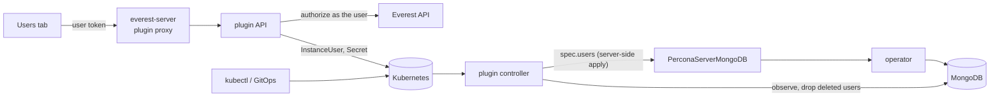

# plugin-user-management

OpenEverest plugin for managing database users and their roles, so teams stop
sharing the admin account and don't need a database shell to onboard an
application. For models served through the Envoy AI Gateway, the same users
are API keys: one per application, team or person, instead of one shared key
per model.

Users are declared as Kubernetes resources, `InstanceUser`, and reconciled
into the instance's database. Create them from the **Users** tab on the
instance page or with `kubectl`/GitOps; either way the plugin keeps the
database in sync, stores generated credentials in a Secret applications can
mount, and drops the user when the resource is deleted.

Supported providers:

| Provider | Engine |
|---|---|
| `percona-server-mongodb` | Percona Server for MongoDB, through the operator's `spec.users` |
| `provider-cloudnative-pg` | CloudNativePG 1.30+, through the operator's `DatabaseRole` resource |
| `provider-kserve` | API keys for models on the Envoy AI Gateway, through the provider's key Secrets |

## InstanceUser

```yaml
apiVersion: plugin-user-management.plugins.openeverest.io/v1alpha1
kind: InstanceUser
metadata:
  name: orders-service
  namespace: team-a          # the instance's namespace
spec:
  instanceRef:
    name: orders-db          # immutable
  username: orders_svc       # immutable
  roles:
    - role: readWrite
      database: orders
    - role: clusterMonitor   # cluster-scoped roles take no database
  # passwordSecretRef:       # optional: bring your own password
  #   name: orders-svc-password
  #   key: password
status:
  phase: Ready               # Pending | Ready | Failed | Deleting
  credentialsSecret: orders-service-credentials
  conditions: [{type: Ready, status: "True"}]
```

- Without `passwordSecretRef` the plugin generates a password into
  `<name>-credentials` with keys `username`, `password` and `uri` (an
  in-cluster connection string). The Secret is owned by the InstanceUser.
  Editing its `password` rotates the password in the database.
- `Ready` means the user exists in the database with exactly the declared
  roles. Role changes go back to `Pending` until the database matches.
- Deleting an InstanceUser drops the user from the database (finalizer
  `plugin-user-management.plugins.openeverest.io/drop-user`). InstanceUsers
  are owned by their Instance, so deleting the instance deletes them.

See [examples/instanceuser.yaml](examples/instanceuser.yaml) (MongoDB),
[examples/instanceuser-postgresql.yaml](examples/instanceuser-postgresql.yaml)
(CloudNativePG) and
[examples/instanceuser-kserve.yaml](examples/instanceuser-kserve.yaml)
(an API key for a model).

## How it works



The backend is one binary with two parts:

- **API** for the UI: authorizes every request against the Everest API with
  the caller's token (see [Permissions](#permissions)), then creates, patches
  or deletes InstanceUsers and their Secrets. It lists users by merging the
  InstanceUsers with the users that exist in the database.
- **Controller** (controller-runtime, leader-elected) reconciling
  InstanceUsers per instance. It hands them to the instance's **engine**,
  which declares them in the database operator's own API, observes the
  database to report status, and drops users that are deleted.

The plugin ships its own CRD and controller rather than relying on the host:
it's the standard Kubernetes extension model and lets the controller watch
what it depends on (the operator's resources, Secrets).

### MongoDB engine

- Declares the users in the `PerconaServerMongoDB` (named after the
  Instance) `spec.users`, with server-side apply under the field manager
  `plugin-user-management`. The provider applies the rest of that resource
  under its own field manager and never sets `spec.users`, so they don't
  conflict. The operator creates the users in the `admin` database, keeps
  their roles in sync and applies password changes from the Secret.
- The operator doesn't remove users that leave `spec.users`, so the
  controller drops deleted users itself, as the operator's user
  administrator (`MONGODB_USER_ADMIN_*` in the users Secret).
- Reads users with `usersInfo` to report status. With `tls.mode: requireTLS`
  it trusts the CA from the cluster's TLS Secret.
- Grantable roles: `read`, `readWrite`, `dbAdmin`, `userAdmin`, `dbOwner` on a
  database; `readAnyDatabase`, `readWriteAnyDatabase`, `dbAdminAnyDatabase`,
  `clusterMonitor` on all databases.

### CloudNativePG engine

- Declares each user as a CloudNativePG `DatabaseRole` named
  `<instance>-<username>-<hash>`, owned by the `Cluster` (named after the
  Instance) and labeled with the instance. The role can log in, is a member of
  the granted roles (`inRoles`) and takes its password from the user's
  Secret. The operator creates the role, grants and revokes memberships and
  applies password changes.
- The plugin labels password Secrets `cnpg.io/reload: "true"` so password
  changes apply right away. CloudNativePG reads the `password` key and checks
  that the Secret's `username` key matches the user: generated Secrets have
  both; a `passwordSecretRef` must use the `password` key and also hold
  `username`.
- `DatabaseRole`s use the `retain` reclaim policy, so deleting one by hand
  keeps the role. To drop a user the controller switches its `DatabaseRole`
  to `delete` and deletes it. The InstanceUser stays `Deleting` until the
  operator has dropped the role; if the role still owns objects, PostgreSQL
  refuses and the operator's error is shown until they're reassigned or
  dropped.
- Reads roles and memberships from `pg_roles` over TLS, verified against the
  cluster's CA, as the application owner (`<cluster>-app`), or the superuser
  when that's the only Secret. When a declared user isn't applied, the
  `DatabaseRole`'s error is reported in the InstanceUser's status.
- `postgres`, `streaming_replica`, `cnpg_*`, the application owner and roles
  in the Cluster's `spec.managed.roles` are listed as system users. Roles
  declared by other `DatabaseRole`s are listed too, even before they exist, so
  the plugin never declares the same role.
- Grantable roles are PostgreSQL's predefined roles, which apply to all
  databases: `pg_read_all_data`, `pg_write_all_data` and `pg_monitor`.
  CloudNativePG declares memberships but not object privileges, so there are
  no per-database roles yet. Usernames are at most 63 characters and can't be
  `postgres`, `streaming_replica` or start with `pg_` or `cnpg_`.
- The connection string points at the read-write service and the
  application database, with `sslmode=require`.
- The operator applies a `DatabaseRole` when it or its Secret changes; it
  doesn't revert changes made to the role in SQL. Such drift shows up as
  `Pending` until the user's roles or password change again.

### KServe engine (API keys for models)

For `llm` and `predictor` Instances of provider-kserve exposed through the
Envoy AI Gateway with API keys on, each user is a consumer of the model with
its own API key. The provider's gateway auth renderer reads key Secrets in the
format described in provider-kserve's
[API keys proposal](https://github.com/openeverest/provider-kserve/blob/main/docs/proposals/ai-gateway-api-keys.md)
(section 6.1), so the request path, quotas and metrics need no changes:

- The password is the API key, generated as `oe_sk_<random>` like the
  provider's own keys. The API and the Users tab never take a chosen key: the
  provider disables every key whose value repeats another one. A
  `passwordSecretRef` (kubectl only) must hold 32 to 128 printable ASCII
  characters without spaces.
- The engine writes one key Secret per user, `<instance>-api-key-<hash>`, in
  the instance's namespace: the key under `api_key`, a key ID
  (`openeverest.io/ai-gateway-key-id`) that is random and kept across
  rotations, the model in `openeverest.io/ai-gateway-models`, the username in
  the `openeverest.io/ai-gateway-key-owner-name` label, and an owner reference
  to the Instance. The provider only accepts keys for models in the key's own
  namespace.
- Reset password rotates the key; deleting the user revokes it. Either takes
  effect on the Gateway within seconds. A key Secret deleted by hand is
  recreated. A missing or unusable `passwordSecretRef` removes the key Secret,
  and the user stays `Pending` with the reason.
- The one role is `invoke`. Usernames are label values: at most 63 letters,
  digits, `-`, `_` or `.`, starting and ending with a letter or digit.
- The credentials Secret also holds `uri`, the Gateway's OpenAI base URL, and
  `model`, the name clients send in the `model` field, both read from the
  Instance's connection Secret. The Users tab says "API key" instead of
  "password" and always generates keys.
- The model's own key from its connection details is listed as a system user
  named after the Instance. Keys other tools wrote for the model are listed as
  not managed.
- Until the model is exposed through the AI Gateway with API keys on, users
  stay `Pending`.
- Token quotas (`tokenLimitPerHour`) apply per key and model, and the Gateway's
  GenAI metrics carry the key ID (`openeverest_key_id`), so usage can be
  attributed to each user. The key Secret maps the key ID to the username.

### Adding an engine

An engine implements one provider ([backend/internal/engine/engine.go](backend/internal/engine/engine.go)):

```go
type Engine interface {
    Roles() []Role                                   // the roles the plugin can grant
    NormalizeRoles([]RoleGrant) ([]RoleGrant, error) // validate against Roles
    ValidateUser(DesiredUser) error                  // engine rules for usernames and password Secrets
    SyncUsers(ctx, target, []DesiredUser) error      // declare all managed users
    ListUsers(ctx, target) ([]User, error)           // users in the database
    AuthDatabase() string
    DropUser(ctx, target, username) error            // ErrInProgress until the user is gone
    ConnectionURI(ctx, target, username, password) (string, error)
}
```

Engines whose operator reports per-user errors can also implement
`PendingReasoner`, to explain in the InstanceUser's status why a user isn't
applied yet. Engines whose users authenticate with API keys implement
`APIKeyEngine` to generate and validate them (the UI then says "API key"), and
engines whose clients need more than a URI implement
`ConnectionPropertiesProvider` to add keys, such as `model`, to the
credentials Secret.

Engines are keyed by provider name (Instance `spec.providerRef.name`) in
[backend/main.go](backend/main.go). Prefer declaring users through the
operator's API when it has one, as the MongoDB engine does. Also add the
engine's RBAC to the chart and the provider to the tab's `providers` (in
[src/main.tsx](src/main.tsx) and the chart values).

## Permissions

| Action (UI/API) | Requires (Everest RBAC) |
|---|---|
| See the Users tab | `use` on the plugin (`plugins`, `<cluster>/plugin-user-management`) |
| List users | `read` on the instance |
| Create, change roles, show credentials, reset password, delete | `read-connection` on the instance |

Changing users takes `read-connection` because whoever can read the
instance's admin credentials can already manage its users with them; the
plugin doesn't introduce a new permission. With `kubectl`, Kubernetes RBAC on
`instanceusers` applies instead.

The controller enforces these rules whichever way an InstanceUser is created:

- **Only a curated set of roles can be granted.** Roles that reach user or
  cluster administration of the whole instance (MongoDB `root`,
  `userAdminAnyDatabase`, `clusterAdmin`, `backup`/`restore`, ...; PostgreSQL
  superuser, `createrole`, `replication`, server file and program access) are
  rejected, and database-scoped roles can't target the `admin`, `config` or
  `local` databases.
- **No takeover of existing accounts.** An InstanceUser whose username
  already exists in the database before the plugin declares it fails, so it
  can't reset the password or roles of an operator system user or of a user
  created outside OpenEverest. Those users are listed read-only.
- One InstanceUser per username and instance; the oldest wins.

## Requirements

- OpenEverest with plugin support (`plugins.extensions.openeverest.io` CRD).
- An instance of a supported provider. The controller connects to the
  database from the plugin's namespace, so NetworkPolicies must allow that.

## Installation

```bash
helm install plugin-user-management charts/plugin-user-management \
  --namespace everest-system
```

Helm installs the InstanceUser CRD from `crds/` but never upgrades or deletes
it. On upgrades apply it first:

```bash
kubectl apply --server-side -f charts/plugin-user-management/crds
```

### Upgrading from 0.1.x

The release after 0.1.x renames the resource from `DatabaseUser` to
`InstanceUser`, since it also holds API keys for models. It's a clean break,
with no migration:

1. Back up and delete your `DatabaseUser`s. The plugin drops their users from
   the database and revokes their API keys.
2. Upgrade the chart (apply the new CRD first, as above).
3. Re-create the users as `InstanceUser`s: from your GitOps manifests with
   `kind` changed, or in the Users tab. The backup shows what they were. They
   get new passwords and API keys, so update the applications that use them.
4. Delete the old CRD.

```bash
kubectl get databaseusers -A -o yaml > databaseusers-backup.yaml
kubectl delete databaseusers --all -A
# upgrade the chart, re-create the users, then:
kubectl delete crd databaseusers.plugin-user-management.plugins.openeverest.io
```

Users whose `DatabaseUser` wasn't deleted before the upgrade stay in the
database unmanaged, and an `InstanceUser` can't take them over. Their
`DatabaseUser`s keep the plugin's finalizer, which nothing removes any more, so
deleting the old CRD waits on them. Remove it by hand:

```bash
kubectl get databaseusers -A --no-headers \
  -o custom-columns=NS:.metadata.namespace,NAME:.metadata.name |
while read -r ns name; do
  kubectl -n "$ns" patch databaseuser "$name" --type merge -p '{"metadata":{"finalizers":null}}'
done
```

| Value | Default | Description |
|---|---|---|
| `plugin.extensionPoints[0].providers` | `[percona-server-mongodb, provider-cloudnative-pg, provider-kserve]` | Providers that get the Users tab |
| `everestAPIURL` | discovered | Everest API the backend authorizes against |

The chart's ClusterRole lets the backend manage InstanceUsers and Secrets,
read Instances, get/patch `perconaservermongodbs`, manage CloudNativePG
`databaseroles` and get `clusters` in every namespace (database namespaces
are created dynamically). It caches only Secrets labeled
`plugin-user-management.plugins.openeverest.io/instance`; the operator's
Secrets are read one by one when needed, and a model's API key Secrets are
listed by label in its namespace.

Because `DatabaseRole`s can declare superusers, write access to them is as
powerful as superuser access to the clusters in their namespace. Grant users
InstanceUsers, not DatabaseRoles.

## API

Served under `/v1/clusters/{cluster}/plugins/plugin-user-management` by
everest-server. Every endpoint takes `?namespace=&instance=`; `{id}` is the
InstanceUser's name.

| Endpoint | Body | Returns |
|---|---|---|
| `GET /api/users` | | `{users, roles, canManage, databaseError?, credentialKind}` |
| `POST /api/users` | `{username, password?, roles}` | `201` credentials |
| `PUT /api/users/{id}/roles` | `{roles}` | `204`; the roles replace the user's roles |
| `GET /api/users/{id}/credentials` | | credentials |
| `POST /api/users/{id}/password` | `{password?}` | credentials |
| `DELETE /api/users/{id}` | | `204` |

Credentials are `{id, username, password, uri?, secret, properties?}`;
`properties` holds further connection details such as `model`. `roles` are
`[{role, database?}]`; `database` is only set for database-scoped roles. An
empty `password` is generated (24 letters and digits). When `credentialKind`
is `apiKey`, the password must be empty and an `oe_sk_` API key is generated.

## Development

```bash
npm install
make test             # backend + frontend tests
make generate         # DeepCopy code and the CRD from backend/api
make build-frontend   # dist/main.js
make docker-build IMG=<registry>/plugin-user-management:dev
```

### Testing on a cluster

With OpenEverest and a supported provider installed on the cluster of your
current kubeconfig context:

```bash
make dev-registry     # throwaway in-cluster registry (dev/registry.yaml)
make dev-deploy       # build, push to it, apply the CRD, helm upgrade --install
kubectl create namespace um-test && kubectl apply -f dev/demo-instance.yaml
kubectl apply -f examples/instanceuser.yaml
# CloudNativePG, with provider-cloudnative-pg installed:
kubectl apply -f dev/demo-instance-postgresql.yaml
kubectl apply -f examples/instanceuser-postgresql.yaml
# API keys, with a provider-kserve model exposed through the AI Gateway:
kubectl apply -f examples/instanceuser-kserve.yaml
```

`make dev-deploy` needs Docker and installs
[crane](https://github.com/google/go-containerregistry) if it's missing. The
dev registry has no auth or TLS; don't use it outside test clusters.

The frontend is an ES module loaded by the Everest UI and shares the host's
React (see [vite.config.ts](vite.config.ts)). The backend embeds it and serves
it at `/main.js`.

### Releasing

Push a `vX.Y.Z` (or `vX.Y.Z-<suffix>`) tag. The release workflow builds the
bundle and a multi-arch image, pushes the image and the Helm chart to GHCR
(`oci://ghcr.io/openeverest/charts/plugin-user-management`) and creates a
GitHub release with notes.

## Roadmap

- Engines for MySQL (`percona-xtradb-cluster`) and Percona PostgreSQL
  (`provider-percona-postgresql`), through their operators' user APIs.
- Per-database PostgreSQL roles (read-only and read-write on one database),
  which need privileges CloudNativePG doesn't declare.
- Custom roles (MongoDB `spec.roles`) as a resource of their own.
- Adopting existing database users into an InstanceUser.
- Configurable role catalog per installation.
