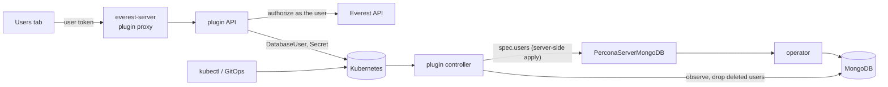

# plugin-user-management

OpenEverest plugin for managing database users and their roles, so teams stop
sharing the admin account and don't need a database shell to onboard an
application.

Users are declared as Kubernetes resources, `DatabaseUser`, and reconciled
into the instance's database. Create them from the **Users** tab on the
instance page or with `kubectl`/GitOps; either way the plugin keeps the
database in sync, stores generated credentials in a Secret applications can
mount, and drops the user when the resource is deleted.

Supported providers:

| Provider | Engine |
|---|---|
| `percona-server-mongodb` | Percona Server for MongoDB, through the operator's `spec.users` |

## DatabaseUser

```yaml
apiVersion: plugin-user-management.plugins.openeverest.io/v1alpha1
kind: DatabaseUser
metadata:
  name: orders-service
  namespace: team-a          # the instance's namespace
spec:
  instanceRef:
    name: orders-db          # immutable
  username: orders_svc       # immutable
  roles:
    - role: readWrite
      database: orders
    - role: clusterMonitor   # cluster-scoped roles take no database
  # passwordSecretRef:       # optional: bring your own password
  #   name: orders-svc-password
  #   key: password
status:
  phase: Ready               # Pending | Ready | Failed | Deleting
  credentialsSecret: orders-service-credentials
  conditions: [{type: Ready, status: "True"}]
```

- Without `passwordSecretRef` the plugin generates a password into
  `<name>-credentials` with keys `username`, `password` and `uri` (an
  in-cluster connection string). The Secret is owned by the DatabaseUser.
  Editing its `password` rotates the password in the database.
- `Ready` means the user exists in the database with exactly the declared
  roles. Role changes go back to `Pending` until the database matches.
- Deleting a DatabaseUser drops the user from the database (finalizer
  `plugin-user-management.plugins.openeverest.io/drop-user`). DatabaseUsers
  are owned by their Instance, so deleting the instance deletes them.

See [examples/databaseuser.yaml](examples/databaseuser.yaml).

## How it works



The backend is one binary with two parts:

- **API** for the UI: authorizes every request against the Everest API with
  the caller's token (see [Permissions](#permissions)), then creates, patches
  or deletes DatabaseUsers and their Secrets. It lists users by merging the
  DatabaseUsers with the users that exist in the database.
- **Controller** (controller-runtime, leader-elected) reconciling
  DatabaseUsers per instance. It hands them to the instance's **engine**,
  which declares them in the database operator's own API, observes the
  database to report status, and drops users that are deleted.

The plugin ships its own CRD and controller rather than relying on the host:
it's the standard Kubernetes extension model and lets the controller watch
what it depends on (the operator's resources, Secrets).

### MongoDB engine

- Declares the users in the `PerconaServerMongoDB` (named after the
  Instance) `spec.users`, with server-side apply under the field manager
  `plugin-user-management`. The provider applies the rest of that resource
  under its own field manager and never sets `spec.users`, so they don't
  conflict. The operator creates the users in the `admin` database, keeps
  their roles in sync and applies password changes from the Secret.
- The operator doesn't remove users that leave `spec.users`, so the
  controller drops deleted users itself, as the operator's user
  administrator (`MONGODB_USER_ADMIN_*` in the users Secret).
- Reads users with `usersInfo` to report status. With `tls.mode: requireTLS`
  it trusts the CA from the cluster's TLS Secret.
- Grantable roles: `read`, `readWrite`, `dbAdmin`, `userAdmin`, `dbOwner` on a
  database; `readAnyDatabase`, `readWriteAnyDatabase`, `dbAdminAnyDatabase`,
  `clusterMonitor` on all databases.

### Adding an engine

An engine implements one provider ([backend/internal/engine/engine.go](backend/internal/engine/engine.go)):

```go
type Engine interface {
    Roles() []Role                                   // the roles the plugin can grant
    NormalizeRoles([]RoleGrant) ([]RoleGrant, error) // validate against Roles
    SyncUsers(ctx, target, []DesiredUser) error      // declare all managed users
    ListUsers(ctx, target) ([]User, error)           // users in the database
    AuthDatabase() string
    DropUser(ctx, target, username) error
    ConnectionURI(ctx, target, username, password) (string, error)
}
```

Engines are keyed by provider name (Instance `spec.providerRef.name`) in
[backend/main.go](backend/main.go). Prefer declaring users through the
operator's API when it has one, as the MongoDB engine does. Also add the
engine's RBAC to the chart and the provider to the tab's `providers` (in
[src/main.tsx](src/main.tsx) and the chart values).

## Permissions

| Action (UI/API) | Requires (Everest RBAC) |
|---|---|
| See the Users tab | `use` on the plugin (`plugins`, `<cluster>/plugin-user-management`) |
| List users | `read` on the instance |
| Create, change roles, show credentials, reset password, delete | `read-connection` on the instance |

Changing users takes `read-connection` because whoever can read the
instance's admin credentials can already manage its users with them; the
plugin doesn't introduce a new permission. With `kubectl`, Kubernetes RBAC on
`databaseusers` applies instead.

The controller enforces these rules whichever way a DatabaseUser is created:

- **Only a curated set of roles can be granted.** Roles that reach user or
  cluster administration of the whole instance (MongoDB `root`,
  `userAdminAnyDatabase`, `clusterAdmin`, `backup`/`restore`, ...) are
  rejected, and database-scoped roles can't target the `admin`, `config` or
  `local` databases.
- **No takeover of existing accounts.** A DatabaseUser whose username
  already exists in the database before the plugin declares it fails, so it
  can't reset the password or roles of an operator system user or of a user
  created outside OpenEverest. Those users are listed read-only.
- One DatabaseUser per username and instance; the oldest wins.

## Requirements

- OpenEverest with plugin support (`plugins.extensions.openeverest.io` CRD).
- An instance of a supported provider. The controller connects to the
  database from the plugin's namespace, so NetworkPolicies must allow that.

## Installation

```bash
helm install plugin-user-management charts/plugin-user-management \
  --namespace everest-system
```

Helm installs the DatabaseUser CRD from `crds/` but never upgrades or deletes
it. On upgrades apply it first:

```bash
kubectl apply --server-side -f charts/plugin-user-management/crds
```

| Value | Default | Description |
|---|---|---|
| `plugin.extensionPoints[0].providers` | `[percona-server-mongodb]` | Providers that get the Users tab |
| `everestAPIURL` | discovered | Everest API the backend authorizes against |

The chart's ClusterRole lets the backend manage DatabaseUsers and Secrets,
read Instances and get/patch `perconaservermongodbs` in every namespace
(database namespaces are created dynamically). It caches only Secrets
labeled `plugin-user-management.plugins.openeverest.io/instance`; the
operator's Secrets are read one by one when needed.

## API

Served under `/v1/clusters/{cluster}/plugins/plugin-user-management` by
everest-server. Every endpoint takes `?namespace=&instance=`; `{id}` is the
DatabaseUser's name.

| Endpoint | Body | Returns |
|---|---|---|
| `GET /api/users` | | `{users, roles, canManage, databaseError?}` |
| `POST /api/users` | `{username, password?, roles}` | `201` credentials |
| `PUT /api/users/{id}/roles` | `{roles}` | `204`; the roles replace the user's roles |
| `GET /api/users/{id}/credentials` | | credentials |
| `POST /api/users/{id}/password` | `{password?}` | credentials |
| `DELETE /api/users/{id}` | | `204` |

Credentials are `{id, username, password, uri?, secret}`. `roles` are
`[{role, database?}]`; `database` is only set for database-scoped roles. An
empty `password` is generated (24 letters and digits).

## Development

```bash
npm install
make test             # backend + frontend tests
make generate         # DeepCopy code and the CRD from backend/api
make build-frontend   # dist/main.js
make docker-build IMG=<registry>/plugin-user-management:dev
```

### Testing on a cluster

With OpenEverest and a supported provider installed on the cluster of your
current kubeconfig context:

```bash
make dev-registry     # throwaway in-cluster registry (dev/registry.yaml)
make dev-deploy       # build, push to it, apply the CRD, helm upgrade --install
kubectl create namespace um-test && kubectl apply -f dev/demo-instance.yaml
kubectl apply -f examples/databaseuser.yaml
```

`make dev-deploy` needs Docker and installs
[crane](https://github.com/google/go-containerregistry) if it's missing. The
dev registry has no auth or TLS; don't use it outside test clusters.

The frontend is an ES module loaded by the Everest UI and shares the host's
React (see [vite.config.ts](vite.config.ts)). The backend embeds it and serves
it at `/main.js`.

### Releasing

Push a `vX.Y.Z` (or `vX.Y.Z-<suffix>`) tag. The release workflow builds the
bundle and a multi-arch image, pushes the image and the Helm chart to GHCR
(`oci://ghcr.io/openeverest/charts/plugin-user-management`) and creates a
GitHub release with notes.

## Roadmap

- Engines for PostgreSQL (`provider-percona-postgresql`) and MySQL
  (`percona-xtradb-cluster`), through their operators' user APIs.
- Custom roles (MongoDB `spec.roles`) as a `DatabaseRole` resource.
- Adopting existing database users into a DatabaseUser.
- Configurable role catalog per installation.
